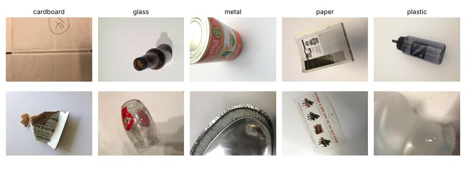
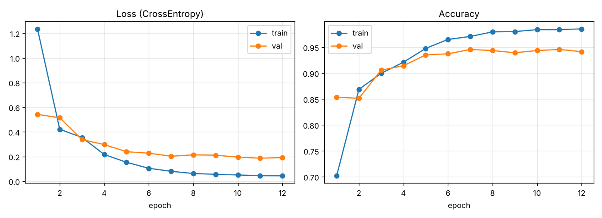
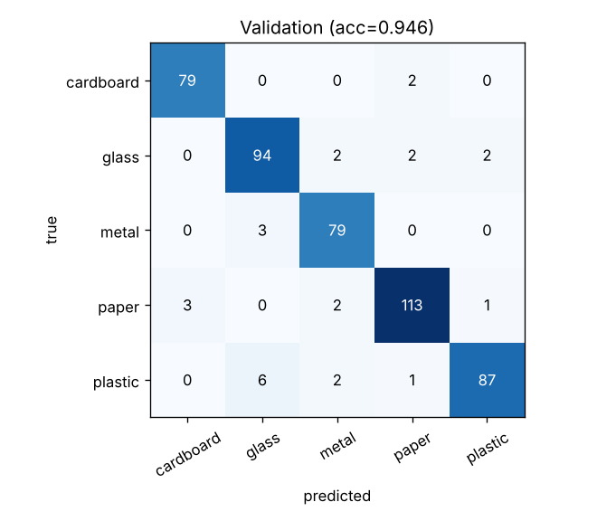
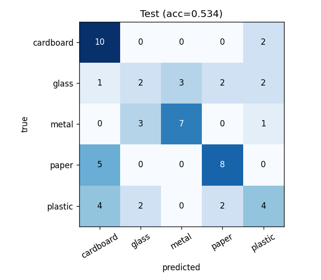
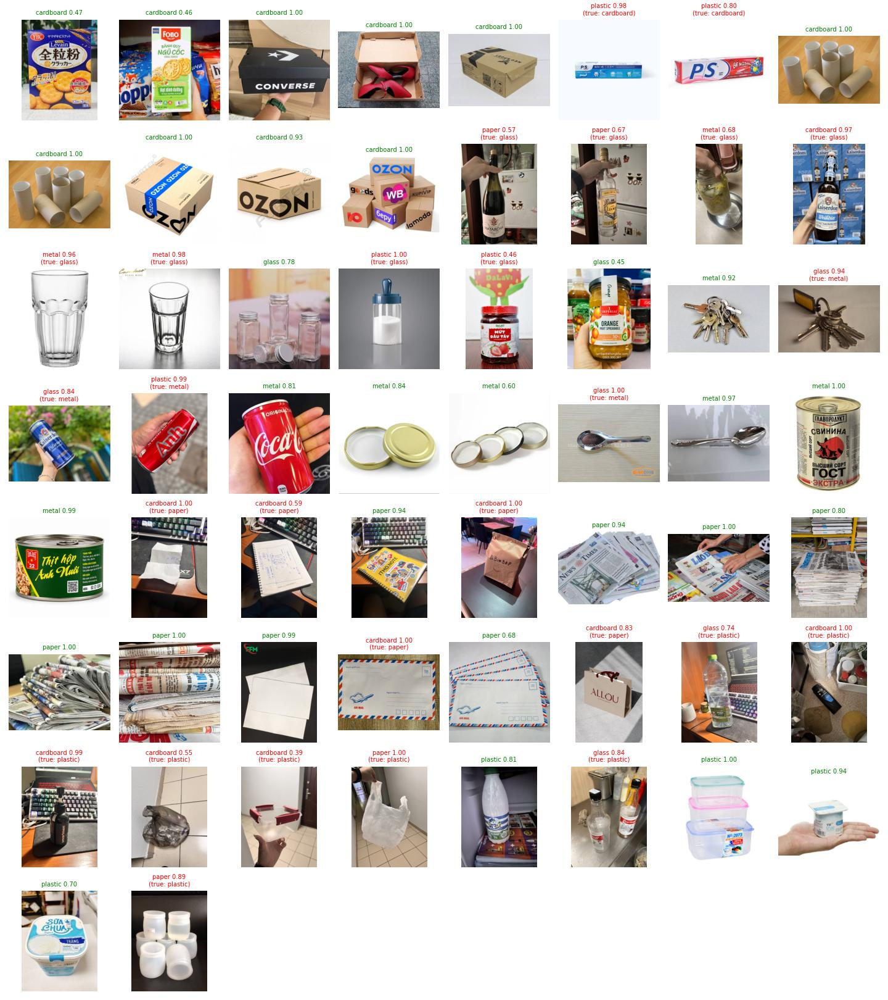

# Лабораторная работа №3. Классификация изображений с помощью сверточной нейронной сети

**Дисциплина:** Компьютерные системы обработки изображений
**Студент:** Зыонг Динь Ань
**Преподаватель:** Денисов А.

**Цель работы:** научиться создавать простые системы классификации изображений на основе сверточных нейронных сетей.

**Задача:** классификация бытовых отходов для сортировки мусора на 5 классов:
`cardboard` (картон), `glass` (стекло), `metal` (металл), `paper` (бумага), `plastic` (пластик).

| | |
|---|---|
| Датасет train/val | TrashNet, 2390 изображений, разбиение 80 / 20 |
| Тестовая выборка | собрана и размечена вручную: 58 изображений (15 собственных фото + 43 из интернета) |
| Сеть | MobileNetV3-Large, предобученная на ImageNet, дообучение всей сети |
| Loss | Cross-Entropy |
| Метрики | Accuracy, macro-F1, precision / recall по классам, матрица ошибок |
| Результат на val | **accuracy 94,6 %, macro-F1 94,6 %** |
| Результат на test | **accuracy 53,4 %, macro-F1 51,0 %** |

---

## 1. Теоретическая база

**Сверточная нейронная сеть (CNN)** — нейронная сеть, в которой основная операция — свёртка: небольшое ядро (например 3×3) скользит по изображению и в каждой точке считает взвешенную сумму пикселей. Веса ядра обучаются. Первые слои находят простые признаки (края, углы, цветовые пятна), глубокие слои — сложные (текстуры, части объектов). Между свёртками стоят нелинейные функции активации и уменьшение разрешения (pooling или свёртка с шагом 2). В конце сети признаки усредняются (global average pooling) и подаются в полносвязный слой, который выдаёт по одному числу (логиту) на каждый класс.

**Перенос обучения (transfer learning).** Обучать CNN с нуля на 2 тыс. изображений плохо — сеть быстро переобучается. Поэтому берётся сеть, уже обученная на ImageNet (1,28 млн изображений, 1000 классов): её слои уже умеют извлекать общие признаки. Последний слой заменяется на новый с 5 выходами, и вся сеть дообучается на своём датасете с маленьким learning rate.

**MobileNetV3-Large** [3] — лёгкая архитектура для мобильных устройств (4,2 млн параметров, ~0,22 GFLOPs):
- *depthwise separable convolution* — свёртка разбита на поканальную 3×3 и точечную 1×1, что в 8–9 раз дешевле обычной;
- *inverted residual block* — канал сначала расширяется, обрабатывается, затем сжимается, с остаточной связью;
- *Squeeze-and-Excitation* — блок, который учится усиливать полезные каналы и ослаблять бесполезные;
- функция активации *h-swish*; архитектура найдена автоматическим поиском (NAS).

**Функция потерь — кросс-энтропия:** `L = −log(p_y)`, где `p = softmax(логиты)`, `p_y` — вероятность правильного класса. Чем увереннее сеть в правильном ответе, тем меньше loss.

**Оптимизация:** AdamW (Adam с правильным weight decay), learning rate 3·10⁻⁴ с косинусным уменьшением до нуля за 12 эпох.

**Аугментация** — случайные преобразования обучающих изображений (вырезание фрагмента, отражения, поворот, изменение яркости/контраста/насыщенности). Каждую эпоху сеть видит немного другие изображения, что снижает переобучение.

**Метрики качества:**
- *Accuracy* — доля правильно классифицированных изображений;
- *Precision* класса — сколько из предсказанных как класс X действительно X; *Recall* — сколько изображений класса X найдено;
- *F1 = 2·P·R / (P + R)*; *macro-F1* — среднее F1 по классам (не зависит от дисбаланса классов);
- *Матрица ошибок* — какие классы путаются между собой.

**Переобучение** — сеть запоминает обучающую выборку, а на новых данных работает хуже. Признаки: train loss продолжает падать, а val loss перестаёт падать или растёт; большой разрыв между train и val accuracy. Защита: аугментация, weight decay, предобученные веса, сохранение лучшей модели по val (early stopping).

## 2. Описание разработанной системы

### Алгоритм
1. `download_data.py` — скачивает TrashNet [1] и раскладывает изображения по папкам `data/<класс>/` (класс `trash` не используется: всего 137 изображений и нечёткое определение).
2. `train.py`:
   - стратифицированное разбиение 80 % train / 20 % val с фиксированным seed (1912 / 478 изображений);
   - train: аугментация + ресайз 224×224 + нормализация ImageNet; val: ресайз + центральный кроп 224×224;
   - создание MobileNetV3-Large (timm [4]) с весами ImageNet и новой головой на 5 классов;
   - обучение 12 эпох, batch 32, после каждой эпохи — оценка на val, лучшая по val accuracy модель сохраняется в `model.pth`;
   - отчёт по метрикам на val, графики loss/accuracy (`results/curves.png`), матрица ошибок (`results/cm_val.png`).
3. `test.py` — загружает `model.pth`, классифицирует собственную тестовую выборку `test/<класс>/`, выводит метрики, матрицу ошибок и сетку изображений с предсказаниями (`results/cm_test.png`, `results/test_grid.jpg`). Учитывает поворот фото с телефона по EXIF.

### Архитектура

```
Изображение 224×224×3
  → MobileNetV3-Large backbone (15 inverted residual блоков, SE, h-swish), веса ImageNet
  → Global Average Pooling → 1×1 conv (1280) → h-swish
  → Linear(1280 → 5)  ← новый слой
  → softmax → {cardboard, glass, metal, paper, plastic}
```

### Структура репозитория
| Файл | Назначение |
|---|---|
| `download_data.py` | загрузка датасета TrashNet |
| `common.py` | классы, преобразования изображений, создание модели |
| `train.py` | обучение и оценка на валидационной выборке |
| `test.py` | оценка на собственной тестовой выборке |
| `plots.py` | построение матрицы ошибок |
| `model.pth` | обученные веса (17 МБ) |
| `test/` | собственная тестовая выборка |
| `results/` | графики, матрицы ошибок, лог обучения |

### Системные требования
- Python 3.10+; библиотеки: `torch`, `torchvision`, `timm`, `scikit-learn`, `matplotlib` (см. `requirements.txt`)
- GPU не обязателен: обучение на CPU занимает ~20 мин, на GPU (CUDA) — несколько минут
- Обучение проверено на машине с 2 ядрами CPU и 7 ГБ RAM

### Запуск
```bash
pip install -r requirements.txt
python download_data.py    # датасет -> data/
python train.py            # обучение -> model.pth, results/
python test.py             # тест на собственных фото из test/
```

## 3. Результаты работы и тестирования

### Датасет
Примеры изображений TrashNet (один объект на белом/светлом фоне, 512×384):



| Класс | cardboard | glass | metal | paper | plastic | всего |
|---|---|---|---|---|---|---|
| Изображений | 403 | 501 | 410 | 594 | 482 | 2390 |
| train / val | 322 / 81 | 401 / 100 | 328 / 82 | 475 / 119 | 386 / 96 | 1912 / 478 |

### Обучение

Обучение проводилось на облачном сервере: CPU Intel Xeon @ 2,10 ГГц, 2 ядра, без GPU. 12 эпох — **1298 с (~22 мин)**, ~108 с на эпоху. Полный лог: [`results/train_log.txt`](results/train_log.txt).



| Эпоха | 1 | 3 | 5 | 7 | 9 | 11 | 12 |
|---|---|---|---|---|---|---|---|
| train loss | 1,236 | 0,355 | 0,153 | 0,080 | 0,055 | 0,044 | 0,043 |
| val loss | 0,542 | 0,338 | 0,239 | **0,202** | 0,210 | 0,186 | 0,191 |
| train acc | 0,702 | 0,900 | 0,948 | 0,971 | 0,980 | 0,984 | 0,985 |
| val acc | 0,854 | 0,906 | 0,935 | **0,946** | 0,939 | 0,946 | 0,941 |

Лучшая модель — после **7-й эпохи** (val accuracy 0,946).

### Качество на валидационной выборке (478 изображений)

**Accuracy = 0,946, macro-F1 = 0,946**

| Класс | Precision | Recall | F1 | Кол-во |
|---|---|---|---|---|
| cardboard | 0,963 | 0,975 | 0,969 | 81 |
| glass | 0,913 | 0,940 | 0,926 | 100 |
| metal | 0,929 | 0,963 | 0,946 | 82 |
| paper | 0,958 | 0,950 | 0,954 | 119 |
| plastic | 0,967 | 0,906 | 0,935 | 96 |



Чаще всего путаются **пластик ↔ стекло** (6 пластиковых объектов распознаны как стекло): прозрачные пластиковые и стеклянные бутылки похожи по форме и бликам. Также встречаются ошибки бумага ↔ картон (похожая текстура).

### Проверка на переобучение
- Первые 4 эпохи val loss падает вместе с train loss — сеть учится.
- После 7-й эпохи train loss продолжает падать (0,080 → 0,043), а val loss остаётся на уровне ~0,19–0,21, val accuracy колеблется около 0,94–0,95.
- Разрыв train/val accuracy в конце ~4 % (0,985 против 0,941).

Вывод: есть **небольшое переобучение** начиная с ~7-й эпохи (сеть дальше «доучивает» train, но на val лучше не становится), однако val loss **не растёт**, поэтому сильного переобучения нет. Дальнейшее обучение не имеет смысла; для использования сохранена модель с лучшим val (7-я эпоха).

### Тестирование на собственной выборке

Тестовая выборка собрана и размечена вручную (разметка — раскладка по папкам `test/<класс>/`): **58 изображений**, из них 15 собственных фотографий на телефон (iPhone) и 43 изображения из интернета (поиск по картинкам). Изображения из готовых датасетов мусора не брались, чтобы не попасть на картинки из TrashNet. В отличие от TrashNet, объекты сняты на разном фоне (стол, клавиатура, пол, магазинная полка), при разном освещении, часто в руке, иногда по несколько штук в кадре.

| Класс | cardboard | glass | metal | paper | plastic | всего |
|---|---|---|---|---|---|---|
| Изображений | 12 | 10 | 11 | 13 | 12 | 58 |
| из них свои фото | 0 | 3 | 0 | 4 | 8 | 15 |

**Accuracy = 0,534, macro-F1 = 0,510**

| Класс | Precision | Recall | F1 | Кол-во |
|---|---|---|---|---|
| cardboard | 0,500 | 0,833 | 0,625 | 12 |
| glass | 0,286 | 0,200 | 0,235 | 10 |
| metal | 0,700 | 0,636 | 0,667 | 11 |
| paper | 0,667 | 0,615 | 0,640 | 13 |
| plastic | 0,444 | 0,333 | 0,381 | 12 |



Предсказания для каждого изображения (зелёный — верно, красный — ошибка, число — уверенность сети):



**Сравнение с валидацией:** accuracy упала с 94,6 % до 53,4 %. Это не переобучение на train (на val из того же распределения всё хорошо), а **сдвиг домена (domain shift)**: в TrashNet каждый объект один, снят сверху на белом фоне при ровном свете, а тестовые изображения сняты в реальных условиях.

Наблюдения:
- **По источникам:** на изображениях из интернета accuracy 67 % (29 из 43), на собственных фото — 13 % (2 из 15). Собственные фото самые «далёкие» от TrashNet: тёмный фон, клавиатура, пол, объект в руке.
- **Тёмный/пёстрый фон → cardboard.** Больше трети ошибок — предсказание «картон» (10 из 27): сеть связывает коричневато-тёмный фон с картоном. Так ошибочно классифицированы пластиковые контейнеры и пакет, тетрадь, бумажный пакет.
- **Glass — худший класс (F1 0,24).** Прозрачные стаканы на светлом фоне распознаны как metal (блики похожи на металлические), бутылки с этикетками в руке — как paper/cardboard. В TrashNet стекло — в основном пустые бутылки и банки без фона.
- **Plastic ↔ glass и plastic ↔ paper:** бутылки с водой и масло в бутылках → glass, белый полиэтиленовый пакет и белые баночки → paper. Пакетов в TrashNet почти нет.
- **Объекты вне распределения train:** ключи, ложки, тюбик зубной пасты в коробке — частично распознаны верно (ключи, ложка — metal), частично нет.
- **Лучше всего:** cardboard (recall 0,83 — коробки Ozon, обувные коробки, втулки), газеты (paper), консервные банки и крышки (metal) — они похожи на объекты TrashNet.

Как улучшить: дообучить на изображениях «из реальной жизни» (разный фон, объект в руке, несколько объектов), усилить аугментацию (случайный фон, сильнее менять яркость/цвет), добавить данные из других датасетов мусора.

Скорость инференса: **16 мс на изображение** на облачном CPU (Xeon, 2 ядра), **18 мс** на локальном компьютере (CPU, batch = 1).

## 4. Выводы

1. Реализована система классификации отходов на 5 классов на основе сверточной нейронной сети MobileNetV3-Large с переносом обучения с ImageNet.
2. За 12 эпох (22 мин на CPU) достигнута точность **94,6 %** (macro-F1 94,6 %) на валидационной выборке. Предобученные веса дают 85 % уже после первой эпохи.
3. Сильного переобучения нет: val loss выходит на плато после 7-й эпохи и не растёт; небольшой разрыв train/val (~4 %) сдерживается аугментацией, weight decay и сохранением лучшей модели по val.
4. Основная сложность — похожие классы: прозрачный пластик и стекло, бумага и картон.
5. На собственной тестовой выборке (58 изображений в реальных условиях) accuracy составила только **53,4 %** (macro-F1 51,0 %). Причина — сдвиг домена: TrashNet снят на белом фоне, а тестовые изображения — на разном фоне и освещении, в руке, по несколько объектов. Хуже всего распознаётся стекло (F1 0,24), лучше всего — картон. Для практического применения сеть нужно дообучать на более разнообразных данных.

## 5. Использованные источники

1. Yang M., Thung G. *Classification of Trash for Recyclability Status*. Stanford CS229, 2016. Датасет TrashNet: https://github.com/garythung/trashnet
2. Документация PyTorch / Torchvision: https://pytorch.org/docs/stable/ , https://pytorch.org/vision/stable/
3. Howard A. et al. *Searching for MobileNetV3*. ICCV 2019. https://arxiv.org/abs/1905.02244
4. Wightman R. *PyTorch Image Models (timm)*. https://github.com/huggingface/pytorch-image-models
5. Loshchilov I., Hutter F. *Decoupled Weight Decay Regularization (AdamW)*. ICLR 2019. https://arxiv.org/abs/1711.05101
6. Goodfellow I., Bengio Y., Courville A. *Deep Learning*. MIT Press, 2016. Гл. 9 «Convolutional Networks».
